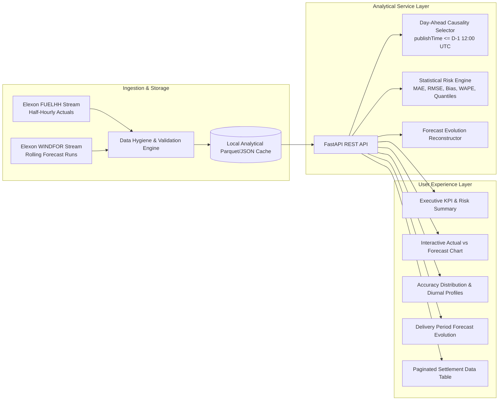

# UK Day-Ahead Wind Forecast & Uncertainty Dashboard

[](https://fastapi.tiangolo.com)
[](https://react.dev)
[](https://www.typescriptlang.org)
[](https://tailwindcss.com)
[](https://www.docker.com)
[](https://opensource.org/licenses/MIT)

An institutional-grade energy analytics platform designed for UK electricity utility trading and procurement desks. The system reconciles Elexon Balancing Mechanism Reporting Service (**BMRS**) outturn data with rolling wind generation forecasts to evaluate day-ahead volume uncertainty, forecast bias, and procurement reserve risk across **January 2026**.

---

## 1. Project Overview & Business Problem

In Great Britain's wholesale electricity market, power procurement desks must commit financial purchase orders by **12:00 noon GMT on day $D-1$** across 48 half-hour Settlement Periods (SPs) to cover expected customer demand net of renewable generation.

Because wind generation is weather-dependent and non-dispatchable:
- **Over-forecasting wind** leaves the utility structurally short, forcing immediate exposure to punitive GB System Buy Prices (Cashout prices).
- **Under-forecasting wind** leads to costly surplus power spill and distress sales.

This application provides procurement teams with:
1. **The latest relevant day-ahead forecast** available at auction gate closure.
2. **Empirical accuracy benchmarks** (MAE, RMSE, Systematic Bias, WAPE).
3. **Volume-at-Risk hedging sizing** via P90/P95 error quantiles.
4. **Forecast evolution tracking** showing how weather forecasts adjusted as physical delivery approached.

---

## 2. Core Architecture



---

## 3. Quickstart & Local Setup

### Option A: Running with Docker Compose (Recommended)

```bash
# Clone the repository
git clone <repository-url>
cd reint-energy-dashboard

# Build and start all services
docker compose up --build
```
- Frontend UI: `http://localhost:3000`
- Backend API & Interactive Docs: `http://localhost:8000/docs`
- Healthcheck: `http://localhost:8000/api/health`

### Option B: Running Natively for Local Development

#### 1. Backend Setup
```bash
cd backend
python -m venv .venv
# On Windows:
.venv\Scripts\activate
# On Linux/macOS:
source .venv/bin/activate

pip install -r requirements.txt
pytest
uvicorn app.main:app --reload --port 8000
```

#### 2. Frontend Setup
```bash
cd frontend
npm install
npm run dev
```
Visit `http://localhost:5173`.

---

## 4. Analytical Methodology & Domain Rules

- **Day-Ahead Gate Closure**: Aligned with EPEX SPOT / Nord Pool GB day-ahead wholesale auction gate closure at **D-1 12:00:00 UTC**. Only forecasts published on or before this timestamp are considered.
- **Settlement Matching**: Elexon `WINDFOR` outputs hourly forecasts (`:00Z`). Elexon `FUELHH` outputs 30-minute settlement period outturns (`:00Z` and `:30Z`). Forecasts are matched across both settlement periods in the forecast hour to preserve 30-minute continuous granularity.
- **December Lookback**: Ingestion includes forecasts published from **December 30, 2025** forward to ensure January 1–2 delivery periods have valid day-ahead forecasts.
- **Metric Formulation**:
  - Signed Error: $e_t = \text{Actual}_t - \text{Forecast}_t$
  - $\text{MAE} = \frac{1}{N} \sum |e_t|$
  - $\text{RMSE} = \sqrt{\frac{1}{N} \sum e_t^2}$
  - $\text{WAPE} = \frac{\sum |e_t|}{\sum \text{Actual}_t} \times 100\%$

---

## 5. AI Attribution

This solution was designed and developed with the assistance of advanced AI agentic systems for accelerated architectural design, code implementation, and API integration. All code, statistical calculations, and domain logic were reviewed, validated against live Elexon data streams, and verified with unit testing suites.
