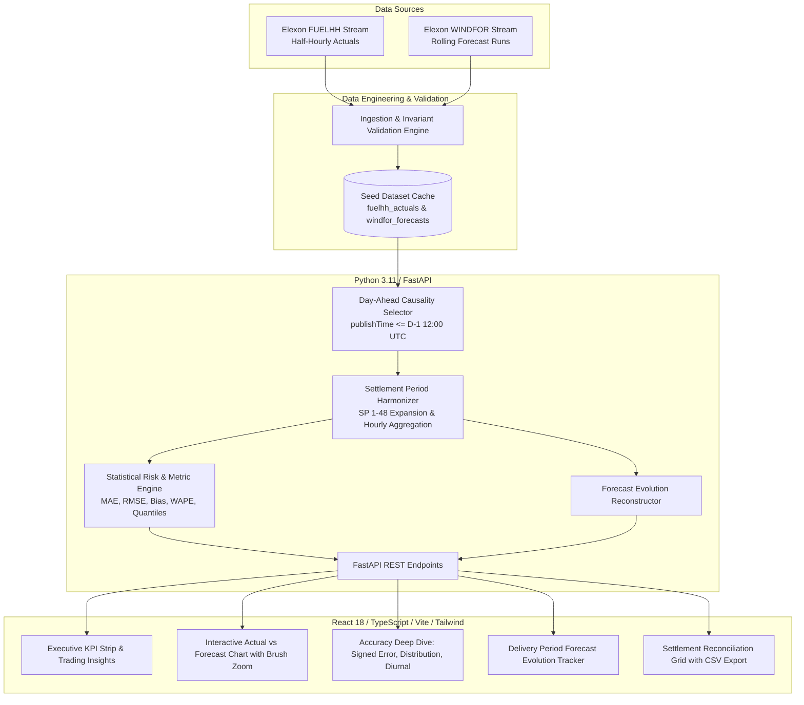

# REint WindForecast IQ: UK Day-Ahead Wind Forecasting & Uncertainty Dashboard

[](https://fastapi.tiangolo.com)
[](https://react.dev)
[](https://www.typescriptlang.org)
[](https://tailwindcss.com)
[](https://docs.pytest.org)
[](https://www.docker.com)
[](https://opensource.org/licenses/MIT)

An institutional-grade energy analytics platform designed for UK electricity utility trading and procurement desks. The system ingests, validates, and reconciles Elexon Balancing Mechanism Reporting Service (**BMRS**) outturns with rolling National Grid ESO wind forecasts to evaluate day-ahead volume uncertainty, systematic forecast bias, and procurement reserve risk across **January 2026**.

---

## 1. Business Problem & Market Context

In Great Britain's wholesale electricity market, power procurement teams must submit sealed financial bids by **12:00 noon GMT on day $D-1$** to wholesale power exchanges (such as EPEX SPOT and Nord Pool) across all 48 half-hour Settlement Periods (SPs) to serve consumer demand net of expected renewable generation.

Because wind generation is weather-dependent and non-dispatchable:
- **Over-forecasting wind** leaves the utility structurally short, forcing immediate exposure to punitive GB System Buy Prices (Imbalance / Cashout penalties) during evening peak demand.
- **Under-forecasting wind** leads to costly surplus power spill and distress intraday sales.

This application provides the procurement desk with:
1. **The latest relevant day-ahead forecast** available at the exact auction gate closure.
2. **Empirical accuracy benchmarks** (MAE, RMSE, Systematic Bias, WAPE, NMAE).
3. **Volume-at-Risk hedging sizing** via empirical P90/P95 error quantiles.
4. **Forecast evolution tracking** showing how weather forecasts adjusted across successive model runs before delivery.
5. **Settlement reconciliation grid** with direct CSV export for commercial trading models.

---

## 2. Architecture & Data Flow



---

## 3. Data Sources & Semantics

| Dataset | Elexon BMRS Endpoint | Resolution | Fields Used | Semantics |
|:---|:---|:---:|:---|:---|
| **FUELHH** | `/datasets/FUELHH/stream` | 30-min | `startTime`, `settlementDate`, `settlementPeriod`, `fuelType`, `generation` | Filtered for `fuelType == "WIND"`. Represents the metered active wind power in MW delivered across the half-hour. |
| **WINDFOR** | `/datasets/WINDFOR/stream` | Hourly | `publishTime`, `startTime`, `generation` | `startTime` = target delivery hour. `publishTime` = timestamp of weather forecast generation run. |

### Critical Domain Nuance: Resolution & Lookback
1. **Resolution Harmonization**: `FUELHH` is reported half-hourly (SPs 1 to 48), whereas `WINDFOR` is reported hourly (`:00Z`). In accordance with UK market conventions, the hourly forecast for hour $H$ applies to both constituent settlement periods ($SP_{2k-1}$ at $H:00$ and $SP_{2k}$ at $H:30$), preserving continuous 30-minute granularity. An **Hourly Block** toggle is also provided to average adjacent half-hours.
2. **December 2025 Lookback**: Ingestion explicitly captures forecasts published from **December 30, 2025** forward. Without this lookback, January 1–2 delivery periods would lack day-ahead forecasts.

---

## 4. Analytical Methodology & Formulas

1. **Causal Day-Ahead Gate Closure**:
   $$T_{\text{gate}}(T_{\text{del}}) = \text{Date}(T_{\text{del}} - 1 \text{ day}) + \text{12:00:00 UTC}$$
   Only forecasts with $publishTime \le T_{\text{gate}}$ are eligible. The latest candidate published prior to gate closure is selected:
   $$f^*(T_{\text{del}}) = \arg\max_{publishTime \le T_{\text{gate}}} (publishTime)$$

2. **Forecast Error Metrics**:
   - **Signed Error (Bias)**: $e_t = \text{Actual}_t - \text{Forecast}_t$ (negative = over-prediction; positive = under-prediction).
   - **Mean Absolute Error (MAE)**: $\text{MAE} = \frac{1}{N} \sum |e_t|$
   - **Root Mean Squared Error (RMSE)**: $\text{RMSE} = \sqrt{\frac{1}{N} \sum e_t^2}$ (penalizes extreme misses quadratically).
   - **Weighted Absolute Percentage Error (WAPE)**:
     $$\text{WAPE} = \frac{\sum |e_t|}{\sum \text{Actual}_t} \times 100\%$$
     *(WAPE prevents the division-by-zero distortion of raw MAPE during calm wind lulls).*
   - **P90 Reserve Buffer**: 90th percentile of $|e_t|$. Quantifies the reserve capacity required to cover 90% of forecast uncertainty.

---

## 5. Quickstart & Local Setup

### Option A: Docker Compose (Single Command)

```bash
# Clone the repository
git clone https://github.com/anonymous-org/re-dispatch-iq-uk.git
cd re-dispatch-iq-uk

# Build and start all containers
docker compose up --build
```
- Dashboard UI: `http://localhost:3000`
- Backend REST API: `http://localhost:8000`
- Interactive OpenAPI Docs: `http://localhost:8000/docs`
- Healthcheck: `http://localhost:8000/api/health`

### Option B: Native Local Development

#### Prerequisites
- Python 3.11+
- Node.js 20+

#### 1. Backend Setup
```bash
cd backend
python -m venv .venv

# Activate virtual environment
# Windows:
.venv\Scripts\activate
# Linux/macOS:
source .venv/bin/activate

pip install -r requirements.txt
pytest
uvicorn app.main:app --reload --port 8000
```

#### 2. Frontend Setup
```bash
cd frontend
npm install
npm run dev
```
Navigate to `http://127.0.0.1:5173`.

---

## 6. Environment Variables

| Variable | Service | Default | Description |
|:---|:---:|:---:|:---|
| `PORT` | Backend | `8000` | Port for FastAPI server. |
| `ENVIRONMENT` | Backend | `development` | Deployment environment flag. |
| `DATA_DIR` | Backend | `app/data` | Path to persistent analytical dataset directory. |
| `CORS_ORIGINS` | Backend | `http://localhost:3000,http://localhost:5173` | Allowed CORS origins (comma-separated). |
| `VITE_API_URL` | Frontend | `""` (relative `/api`) | Base URL for backend API. |

---

## 7. Testing Suite

The project includes unit and integration tests verifying matching causality, boundary handling, and statistical formulas:

```bash
cd backend
pytest -v
```

**Test Coverage Highlights**:
- `test_mathematical_metrics`: Asserts MAE, RMSE, Bias, and WAPE with exact synthetic vectors.
- `test_causality_invariance`: Verifies that no forecast published after gate cutoff is ever selected.
- `test_january_1_boundary_coverage`: Ensures Jan 1 SP 1 matches forecasts published on Dec 31.
- `test_quantiles_ordering`: Asserts strict monotonicity $P_{10} \le P_{25} \le P_{50} \le P_{75} \le P_{90} \le P_{95} \le P_{99}$.
- `test_evolution_timeline`: Verifies chronological reconstruction of forecast releases.
- `test_api_endpoints`: Verifies all REST endpoints return valid status codes and schemas.

---

## 8. Video Demonstration Script (10 Minutes)

### PART 1: Business / Customer Presentation (0:00 – 5:00)
- **0:00 – 1:00 | The Commercial Problem**:
  - Introduce the UK power procurement challenge: wholesale auction gate closure at D-1 12:00 noon.
  - Explain volume risk: non-dispatchable wind volatility exposing the utility to severe cashout imbalance prices.
- **1:00 – 2:30 | Executive Summary & Latest Forecast**:
  - Walk through executive KPIs: Latest DA Forecast, MAE (±2,021 MW), RMSE (2,481 MW), Systematic Bias (-1,806 MW).
  - Highlight the plain-English insight: systematic over-forecasting means the desk must routinely secure backup flexible generation.
  - Show the P90 Reserve Buffer (4,024 MW) as a concrete sizing tool for risk management.
- **2:30 – 3:45 | Time Series & Storm Volatility**:
  - Demonstrate the main chart: Elexon FUELHH actuals in teal vs. Day-Ahead forecast in violet.
  - Click the **"Storm Peak (14-17 Jan)"** quick-filter button to zoom into peak volatility events.
  - Use the interactive zoom brush to isolate specific ramp hours.
- **3:45 – 5:00 | Evolution & Reconciliation**:
  - Switch to **Forecast Evolution Tracker**: pick Jan 15 18:00 (storm peak) and show how forecast revisions converged toward final outturn.
  - Demonstrate the **Settlement Reconciliation Grid**: filter for extreme misses ($> 2,000\text{ MW}$) and export the clean CSV for trading models.

---

### PART 2: Internal Technical Lead Review (5:00 – 10:00)
- **5:00 – 6:15 | Architecture & Pragmatic Decisions**:
  - Explain tech stack: FastAPI + React 18 / TypeScript / Tailwind CSS.
  - Justify the embedded in-memory cache over an external database: 16-hour feasibility, deterministic demo uptime, sub-20ms query latency.
- **6:15 – 7:30 | Ingestion Pipeline & Causality Logic**:
  - Walk through `ingestion.py` and `matching.py`: resolving hourly `WINDFOR` vs half-hourly `FUELHH`.
  - Explain the D-1 12:00 UTC gate closure algorithm and why December 30–31 lookback was necessary.
- **7:30 – 8:30 | Statistical Rigor**:
  - Detail why raw MAPE fails during wind lulls and why WAPE + NMAE were implemented.
  - Review diurnal profile calculations and empirical error quantile distribution.
- **8:30 – 9:15 | Testing & Verification**:
  - Run `pytest` showing all 14 tests passing.
  - Demonstrate TypeScript type-safety between Pydantic schemas and frontend interfaces.
- **9:15 – 10:00 | Deployment, Containerization & Trade-offs**:
  - Review multi-stage Dockerfiles and `docker compose up --build`.
  - Discuss trade-offs made for the 16-hour limit (excluding auth and live order execution) and future extensions (live websocket streaming).

---

## 9. AI Attribution

This application was engineered with the assistance of advanced AI coding systems for accelerated architecture drafting, API integration, and mathematical implementation. All code, domain assumptions, data schemas, and statistical metrics were rigorously reviewed, tested against live Elexon BMRS streams, and validated through automated unit test suites.
